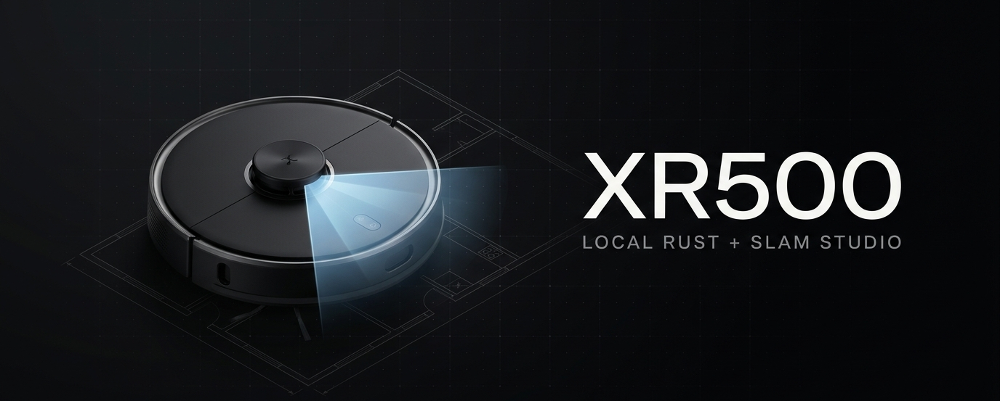

<div align="center">



<br />

<p>
  <strong>Local Rust + React controller for Liectroux XR500 (Xiamen Lilin T2/T3) robot vacuums.</strong><br />
  Connects directly over LAN using the onboard HoSLAM map stream (TCP 9999) and Tuya v3.3 local protocol (TCP 6668). No Tuya Cloud account or internet access is required at runtime.
</p>

<p>
  
  
  
  
  
</p>

<p>
  <a href="#features">Features</a> &nbsp;·&nbsp;
  <a href="#quick-setup">Quick Setup</a> &nbsp;·&nbsp;
  <a href="#usage">Web Studio & CLI</a> &nbsp;·&nbsp;
  <a href="#verified-xr500t3-protocol">Protocol</a> &nbsp;·&nbsp;
  <a href="#run-on-boot-systemd">Systemd</a>
</p>

</div>

---

## Features

| Capability | What it does |
| :--- | :--- |
| **Single Native Binary** | Rust (`tokio` + `axum` + `rust-embed`) compiles the backend, CLI, LAN scanner, and embedded React UI into one standalone binary. |
| **Local SLAM Stream** | Reads the vacuum's live occupancy grid (`hoslmap\0`), cleaned area (`hoslcac\0`), and 1 Hz trajectory (`hosltraj`) directly from onboard TCP port `9999` without Tuya Cloud. |
| **Quick Map & Room Management** | Silent house-mapping mode (suction and water off) for unmapped robots, plus room auto-segmentation (`DP 101`) and map reset (`DP 13`). |
| **Permanent Custom Places** | Define clickable named areas that span across multiple rooms (e.g., a corridor, under a dining table, or entryway) and clean them with one click. |
| **Multiple Cleaning Modes** | Select native rooms (`1`), saved places (`N`), rectangular zones (`2`), freehand brush spots (`3`), go-to/spot pins (`4`), or saved presets. |
| **Poop Guard** | Drop `DP 15 (0x1A)` No-Go exclusion bubbles (`5`/`P`), optional pre-flight floor confirmation, and optional webcam anomaly auto-halt. |
| **Hardware Controls** | Suction, mop water flow, Y-pattern mop (`DP 104`), edge clean, speaker volume (`DP 26`), DND (`DP 25`), consumables (`DP 17/19/21/23`), and manual RC drive (`DP 12`). |

---

## Quick Setup

### 1. Build the Single Binary
The React frontend is pre-built in `static/` and automatically embedded into the Rust binary at compile time.

```bash
git clone https://github.com/shinjuku712/xr500-re.git
cd xr500-re
cargo build --release
```

Your binary is ready at `./target/release/xr500`.

### 2. Scan Your Wi-Fi Subnet
Make sure your machine is on the same Wi-Fi network as the vacuum:

```bash
./target/release/xr500 scan
```

Note your **IP Address** (e.g. `192.168.x.x`) and **Device ID (`gwId`)**.

### 3. Configure `.env`
- **Live SLAM Maps & Tracking (`Port 9999`):** Unencrypted TCP — only requires the robot's LAN IP.
- **Sending Commands (`Port 6668`):** The stock firmware encrypts local TCP commands with a device-specific 16-character AES-128 `LOCAL_KEY`. You only need to obtain this key once (either offline from flash via internal Micro-USB / 3.3V UART — see [`docs/hardware_notes.md`](docs/hardware_notes.md) — or via a one-time export from an existing Smart Life / Tuya Smart pairing). After that, Tuya Cloud is not used.

```bash
cp .env.example .env
```

Edit `.env` (wrap `LOCAL_KEY` in single quotes if it contains special characters):

```ini
DEVICE_IP=192.168.1.100
DEVICE_ID=your_device_id_here
LOCAL_KEY='your_16_char_local_key'
DEVICE_PORT=6668
SIMULATION_MODE=false
```

> [!IMPORTANT]
> **Force-close the Tuya / Smart Life mobile app** before connecting — Tuya vacuums only accept **one active local TCP socket** on port `6668` at a time.

---

## Usage

### Launch the Local Web Studio
```bash
./target/release/xr500 web --host 127.0.0.1 --port 4185
```
Open **`http://127.0.0.1:4185`** in your browser.

| Shortcut | Action |
| :---: | :--- |
| `1` | **Select** rooms or permanent Custom Places (double-click to rename/edit) |
| `N` | **`+ Place`** — drag a box over any multi-room area (e.g. Corridor) to save permanently |
| `2` | **Zone** — draw one-off rectangular cleaning zones |
| `3` | **Brush** — freehand paint spots to deep-clean |
| `4` | **Pin** — drop a Go-To or Spot Clean target pin |
| `5` / `P` | **💩 Poop Pin** — drop a No-Go exclusion bubble (pushed via `DP 15 0x1A`) |
| `6` / `7` | **No-Go Zone** / **Virtual Wall** |
| `8` / `H` | **Pan** map (or middle-click / `Alt+Drag` in any mode) |
| `R` | Reset zoom & fit entire house to screen |
| `Esc` | Clear current selection |

### Native CLI
```bash
xr500 scan                         # UDP 6667 LAN discovery
xr500 status                       # Live JSON telemetry from port 6668
xr500 locate                       # Trigger audible "I am here" chime
xr500 start | pause | dock         # Mission controls
xr500 suction strong               # turnoff | gentle | normal | strong
xr500 water high                   # closed | low | middle | high
xr500 clean-rooms 0 2 --passes 2   # Clean specific room IDs via DP 15 (0x14)
xr500 raw-set 26 80                # Set any raw DP directly
```

### Frontend Development (Optional)
```bash
cd web-ui
npm install
npm run dev       # Vite dev server on :5173 (proxies /api -> :8000)
npm run build     # Rebuilds production bundle into static/ (re-run cargo build to embed)
```

---

## Verified XR500T3 Protocol

Reverse-engineered and hardware-verified on live **Liectroux XR500T3** (`Lilin T3`):

- **Onboard HoSLAM Live Stream (Local TCP Port `9999`, Unencrypted):**
  - `b'hoslmap\0'` + `u32_le len` + `6 × u32_le (dock_x, dock_y, origin_x, origin_y, width, height)` + raw probabilistic occupancy grid (`128`=unknown, `<112`=wall, `>136`=free floor).
  - `b'hoslcac\0'` + `u32_le len` + `f32_le area_m2` + `u32_le duration_s`.
  - `b'hosltraj'` + `u32_le len` + `N × (f32_le x, f32_le y)` where pixel coordinates are `px = origin_x - y`, `py = origin_y - x`.
- **Tuya Local v3.3 (`Port 6668`, AES-128-ECB + CRC32):**
  - Core DPs: `1` (`switch_go`), `2` (`pause`), `3` (`switch_charge`), `4` (`mode`), `5` (`status`), `6` (`clean_time`), `7` (`clean_area`), `8` (`battery`), `9` (`suction`), `10` (`cistern`), `11` (`seek`), `12` (`direction_control`), `15` (`command_trans`), `17/19/21/23` (consumables), `25` (`dnd`), `26` (`volume`), `27` (`break_clean`), `28` (`fault`), `104` (`y_mop`).
  - `DP 15` (`command_trans`) binary frame: `[0xAA][len_hi][len_lo][cmd][...data][sum(cmd+data) & 0xFF]`
    - `0x14` → **Select Rooms:** `[passes][room_count][...room_ids]`
    - `0x28` → **Zone Clean:** `[1][zone_count] + N × [4][4 × (x, y) i16_be]`
    - `0x16` → **Go-To Point:** `[x i16_be][y i16_be]`
    - `0x1A` → **No-Go / Poop Zones:** `[zone_count] + N × [0][4][4 × (x, y) i16_be]`
  - **Clockwise Polygon Requirement:** XR500T3 SLAM polygons **must use Clockwise (`CW`) vertex winding** (`top-left → top-right → bottom-right → bottom-left`). Counter-clockwise boxes cause the robot to abort at the zone boundary and return to dock.

Deep-dive docs:
- [`docs/dp_schema.json`](docs/dp_schema.json) — Complete DP definitions for T2 & T3 revisions
- [`docs/raw_payloads.md`](docs/raw_payloads.md) — Binary struct layouts
- [`docs/hardware_notes.md`](docs/hardware_notes.md) — SoC, UART 3.3V, Micro-USB, and `code.pack` firmware notes

---

## Run on Boot (`systemd --user`)

Create `~/.config/systemd/user/xr500-web.service`:

```ini
[Unit]
Description=Liectroux XR500 Local Web Controller
After=network-online.target

[Service]
Type=simple
WorkingDirectory=/path/to/xr500-re
ExecStart=/path/to/xr500-re/target/release/xr500 web --host 127.0.0.1 --port 4185
Restart=always
RestartSec=5
EnvironmentFile=/path/to/xr500-re/.env

[Install]
WantedBy=default.target
```

```bash
systemctl --user daemon-reload
systemctl --user enable --now xr500-web.service
```

---

## License

Released under the [MIT License](LICENSE).
